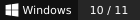
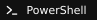
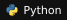
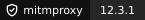
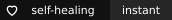
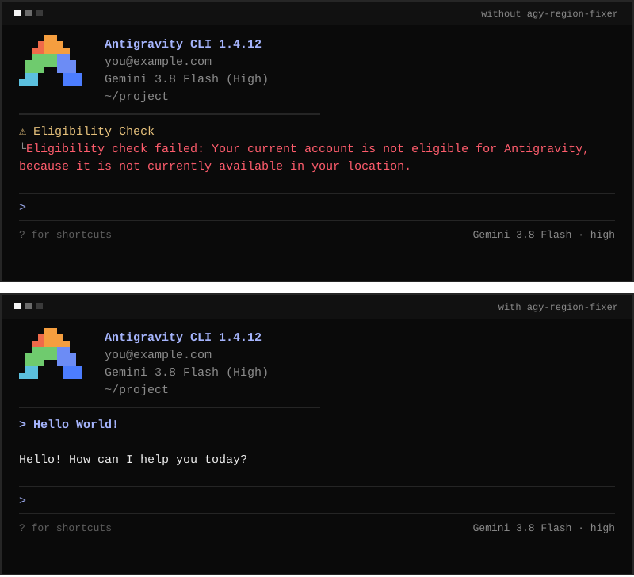
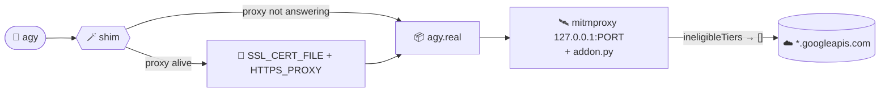
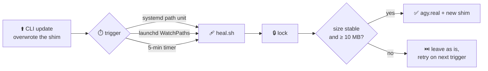

<div align="center">

<br><br>

  <br>
  <br>
   <br><br>

<a href="README.md">🇬🇧 English</a> · <a href="README.ru.md">🇷🇺 Русский</a> · <a href="README.zh.md">🇨🇳 中文</a>

<br><br>
<a href="https://github.com/nazavod777/agy-region-fixer/actions/workflows/cross-platform-test.yml"></a>

</div>

# 🌍 agy-region-fixer

> **Antigravity CLI region-block bypass** — one installer for 🐧 Linux, 🍎 macOS and 🪟 Windows that survives CLI updates.

Google restricts access by the account's country. A local MITM proxy strips `ineligibleTiers` from the `loadCodeAssist` response — the CLI sees only `allowedTiers` and lets you in. Requests to Google are **not modified**, the `agy` binary is **not patched**.

> [!WARNING]
> Bypassing a regional restriction violates Google's ToS. Use at your own risk, only with your own account and subscription.

## ✨ Features

| Feature | What it means |
|---|---|
| 🧩 **No patching** | `agy` stays untouched and sits next to the shim as `agy.real` — CLI updates break nothing |
| ⚡ **Instant self-healing** | after an update the shim comes back in seconds (Linux/macOS) or within 5 minutes (Windows) |
| 🛡️ **Safe heal** | on Linux it runs as the file's owner, not root; half-written updates are never clobbered |
| 🔒 **Localhost only** | the proxy listens on `127.0.0.1`; only `*.googleapis.com` responses are cleaned |
| 🧪 **CI-tested** | full cycle on real Linux / macOS / Windows: install → update → heal → uninstall |
| 🧹 **Clean uninstall** | `uninstall` puts the binary back and removes everything else |

## 🎯 What it fixes

Exactly **one** thing — the region warning that Antigravity CLI shows right after start:

<div align="center">

<br><sub>Illustration of the message and of the result, not a literal screenshot.</sub>
</div>

> `Eligibility check failed: Your current account is not eligible for Antigravity, because it is not currently available in your location.`

| ✅ Fixes | ❌ Does not fix |
|---|---|
| The region **Eligibility Check** error above | Login — you still need a working `agy login` |
| | Subscription, quota or rate limits |
| | Model availability or any server-side restriction on the account |
| | Any other error — if the message differs, this tool will not help |

## 🚀 Installation

Install and log in to Antigravity CLI first (`agy login`), then:

<table>
<tr><td>🐧 <b>Linux</b><br><sub>systemd: Ubuntu, Debian, Kali, Fedora, Arch, openSUSE</sub></td><td>

```bash
curl -fsSL https://raw.githubusercontent.com/nazavod777/agy-region-fixer/master/install.sh | sudo bash
```

</td></tr>
<tr><td>🍎 <b>macOS</b><br><sub>12+, Xcode Command Line Tools</sub></td><td>

```bash
curl -fsSL https://raw.githubusercontent.com/nazavod777/agy-region-fixer/master/install.sh | bash
```

</td></tr>
<tr><td>🪟 <b>Windows 10/11</b><br><sub>Python 3.12/3.13 from python.org, no admin rights needed</sub></td><td>

```powershell
powershell -NoProfile -ExecutionPolicy Bypass -Command "iex (irm https://raw.githubusercontent.com/nazavod777/agy-region-fixer/master/install.ps1)"
```

</td></tr>
</table>

> [!NOTE]
> The `curl | bash` and `iex (irm …)` one-liners fetch `addon.py` from raw.githubusercontent.com. Prefer to review first? Clone the repo and run `bash install.sh` / `install.ps1` from its directory — `addon.py` is picked up next to it. To use your own copy, set `AGY_ADDON_URL=...`.

**What the installer does:** installs mitmproxy into an isolated venv (system Python untouched) → sets up proxy autostart (systemd / launchd / HKCU Run) → moves the real binary to `agy.real` and installs a shim → enables self-healing → runs an `agy -p` smoke test.

### 📋 Requirements

- 🐍 Python **3.12 or 3.13** (required by mitmproxy 12.x), a complete build with `ctypes`, `ssl` and `zlib`. The installer checks every `python3.13`/`python3.12`/`python3` on `PATH` and skips incomplete ones — e.g. a self-built Python without `libffi-dev`
- 🌐 `curl`, and an installed, logged-in Antigravity CLI
- 📦 **Any way of installing `agy`** — the installer finds it the way your own shell does (`sudo` hides `~/.local/bin`, `/snap/bin`, nvm, bun, cargo…):
  - a plain binary, an npm/brew/cargo link, a root-owned `/usr/local/bin/agy` → the binary is moved to `agy.real` and replaced by the shim;
  - **snap, Nix** (a launcher that must not be touched) → the launcher stays as is, and a wrapper is placed earlier in your `PATH` (`~/.local/bin`). For a snap the CA certificate is copied into `~/snap/<name>/common/agy-region-fixer`, where the confined app can read it.
- 🐧 Linux: systemd plus `runuser` or `setpriv` (both ship in `util-linux`)

## ⚙️ How it works



- `agy` → shim → if the proxy is alive, sets `SSL_CERT_FILE` (local CA) and `HTTPS_PROXY=127.0.0.1:PORT` → the real binary `agy.real`
- if the proxy is down the shim just calls `agy` without it: you get the old eligibility error, but nothing breaks
- by default the log holds only cleaning facts (`CLEANED …`)

## 🩹 Self-healing after CLI updates

Do nothing: the CLI updater overwrites the shim, the healer puts it back.



| OS | Trigger | Delay |
|---|---|---|
| 🐧 Linux | systemd path unit + timer | seconds |
| 🍎 macOS | launchd `WatchPaths` + `StartInterval` | seconds |
| 🪟 Windows | scheduled task `agy-region-fixer-heal` | ≤ 5 minutes |

Before swapping, heal waits until the file stops growing (up to ~30 s) and checks that it looks like a real binary (≥ 10 MB; on Windows also the `MZ` signature). Broken or half-written files are left alone and only logged. Two heals never overlap: work happens under a lock, so the real binary cannot be lost.

Force it manually:

- 🐧 `sudo agy-bypass-heal`
- 🍎 `bash ~/.agy-region-fixer/heal.sh`
- 🪟 wait ≤ 5 minutes or run `powershell %USERPROFILE%\.agy-region-fixer\heal.ps1`

## 🔐 Security model

On Linux heal is started by root (systemd) while the directory holding `agy` usually belongs to the user. So that the user cannot turn this into a root-level write (a planted symlink, a race on a temp file):

- 👤 **all work on the binary runs as its owner** (`runuser`/`setpriv`); root only takes the lock and writes the log
- 🚫 if only root can write to the target directory while the `agy` path sits in a user-controlled one (e.g. a link to a system file), heal **refuses** instead of acting as root
- 🔑 no `chown`: file ownership stays as it was
- 🧱 `AGY_BYPASS_PREFIX` is validated: absolute path, not `/` or `$HOME`, no `\ " ' % $` characters
- 🌐 the proxy listens on `127.0.0.1` only; keys and tokens never leave the machine

## 🔧 Configuration

| Variable | Default | Purpose | OS |
|---|---|---|---|
| `AGY_BYPASS_PORT` | automatic | proxy port | 🐧 🍎 🪟 |
| `AGY_BYPASS_PREFIX` | `/opt/agy-region-fixer` · `~/.agy-region-fixer` | install directory | 🐧 🍎 |
| `AGY_BYPASS_BIN` | `agy` found in `PATH` | path to the CLI binary | 🐧 🍎 |
| `AGY_ADDON_URL` | raw.githubusercontent.com | where to fetch `addon.py` for a piped install | 🐧 🍎 🪟 |

The default is a randomly selected free localhost port in `49152–65535`, saved in `<install directory>/port`. A reinstall reuses that high port when available; otherwise it selects another. `AGY_BYPASS_PORT` explicitly fixes the port and fails if it is occupied. The installer prints the actual address and updates the proxy and all wrappers together. Ctrl+C stops the installer and its temporary commands; an already started background proxy remains until you run uninstall.

```bash
AGY_BYPASS_PORT=8081 bash install.sh          # Linux: with sudo
```
```powershell
$env:AGY_BYPASS_PORT="8081"; powershell -ExecutionPolicy Bypass -File install.ps1
```

## 🧹 Uninstall

- 🐧 `sudo /opt/agy-region-fixer/uninstall.sh`
- 🍎 `bash ~/.agy-region-fixer/uninstall.sh`
- 🪟 `powershell -ExecutionPolicy Bypass -File %USERPROFILE%\.agy-region-fixer\uninstall.ps1`

Removes the proxy, tasks and shim; the `agy` binary goes back in place — even if an interrupted update left it only as `agy.real`.

## 🩺 Diagnostics

| OS | Proxy log | Service log |
|---|---|---|
| 🐧 Linux | `/opt/agy-region-fixer/mitm.log` | `journalctl -u agy-region-fixer -e` |
| 🍎 macOS | `~/.agy-region-fixer/mitm.log` | `~/.agy-region-fixer/launchd.err` |
| 🪟 Windows | `%USERPROFILE%\.agy-region-fixer\mitm.log` | `…\mitm-stdout.log` |

🔎 **Verbose mode:** logging every URL is switched on with a `verbose.flag` file in the install directory (`touch /opt/agy-region-fixer/verbose.flag`; on Windows create the file in `%USERPROFILE%\.agy-region-fixer`). No proxy restart needed — the flag is checked on every request; delete the file to turn it off.

🔬 In verbose mode the addon also logs the **shape** of every JSON answer from Google (`SHAPE <method> <url> <status> -> {field: type}`): field names and types only, never values (except enumerations such as `reasonCode` and `tierId`). If the warning stays after installing, this is what shows whether the API changed — attach the `SHAPE` lines to an issue.

If the proxy is listening but the warning remains, check that `addon.py` still exists in the install directory and the service log has no `Un-loading script` entry. Deleting the directory while the proxy is running unloads the addon, even though HTTPS traffic still passes through. Rerun the installer to restore the files and restart the proxy; use the uninstall script when removing it.

## ⚠️ Limitations

- 🪟 Windows: only a plain `agy.exe` in `PATH` gets the shim. An npm `.cmd`, a WindowsApps alias or a scoop shim is detected and reported, with the command to run `agy` through the proxy by hand.
- 🪟 Windows: the shim is `agy.cmd`. Consumers that call `agy.exe` strictly via CreateProcess (bypassing `PATHEXT` resolution) will not see it. The CLI and PowerShell work.
- 🧬 If Google changes the response format (renames the field or moves to binary proto) the addon stops cleaning; fixed with a one-line change in `addon.py`.
- 📌 If `agy` starts certificate pinning (Go clients almost never do) this approach would need rework.

## ✅ Test status

CI (GitHub Actions) runs the full lifecycle on live machines: install → proxy + CA + MITM check → shim → simulated CLI update → self-healing → race, planted-link and symlink-attack checks → clean uninstall that restores the binary.

| 🐧 ubuntu-latest | 🍎 macos-latest | 🪟 windows-latest |
|:---:|:---:|:---:|
| ✅ systemd | ✅ launchd | ✅ HKCU Run + schtasks |

A real `agy login` and Google traffic are not tested in CI (fake `agy`); the Linux path was additionally verified live with the real CLI and model (`BYPASS_OK`).

## 🗂️ Layout

```
agy-region-fixer/
├── install.sh      # 🐧🍎 Linux / macOS installer (generates heal.sh, uninstall.sh)
├── install.ps1     # 🪟 Windows installer
├── addon.py        # 🧩 mitmproxy addon — the single source of the cleaning logic
├── assets/         # 🎨 README SVGs
└── .github/workflows/cross-platform-test.yml
```

## 🤝 Credits

| Role | Who |
|---|---|
| 👤 **Author & maintainer** | [**nazavod777**](https://github.com/nazavod777) |
| 🤖 **Built with AI tools** | **Claude** & **Claude Code** (Anthropic) · **Hermes** (agent harness) · **GLM** models (Z.ai) · **T3 Code** (terminal) |

The AI tools above were used as development assistants — thanks to their teams. Design decisions, review and responsibility for the code stay with the author.

## 📄 License

[MIT](LICENSE)

---

<div align="center"><sub>Like the project? Support the author ☕</sub></div>

<div align="center">

<a href="https://nazavod.dev"></a> <a href="https://t.me/bio_nazavod"></a> <a href="https://github.com/nazavod777"></a> <a href="https://x.com/nazavod777"></a> <a href="https://antidrain.me"></a>

<br><br>
<a href="https://nazavod.dev/coffee/"></a>

</div>
