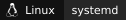
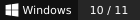
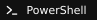
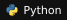
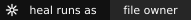
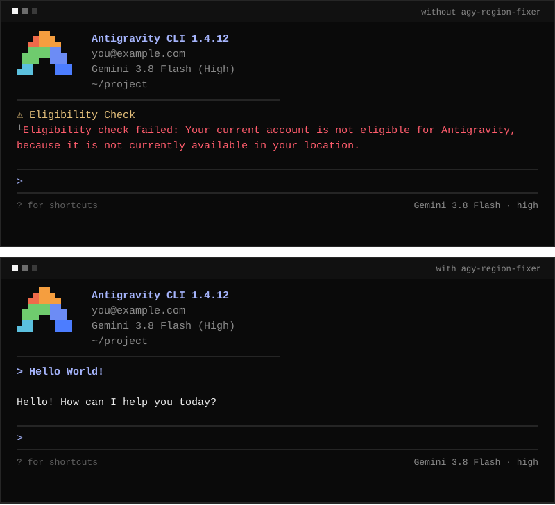
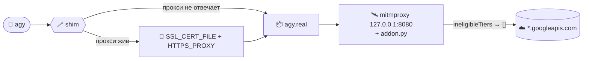

<div align="center">

<br><br>

  <br>
  <br>
   <br><br>

<a href="README.md">🇬🇧 English</a> · <a href="README.ru.md">🇷🇺 Русский</a> · <a href="README.zh.md">🇨🇳 中文</a>

<br><br>
<a href="https://github.com/nazavod777/agy-region-fixer/actions/workflows/cross-platform-test.yml"></a>

</div>

# 🌍 agy-region-fixer

> **Обход региональной блокировки Antigravity CLI** — один установщик, который работает на 🐧 Linux, 🍎 macOS и 🪟 Windows и переживает обновления CLI.

Google режет доступ по стране аккаунта. Локальный MITM-прокси вычищает `ineligibleTiers` из ответа `loadCodeAssist` — CLI видит только `allowedTiers` и пускает пользователя. Запросы к Google **не изменяются**, бинарь `agy` **не патчится**.

> [!WARNING]
> Обход регионального ограничения нарушает ToS Google. Используй на свой страх и риск, только со своим аккаунтом и подпиской.

## ✨ Возможности

| Возможность | Что это значит |
|---|---|
| 🧩 **Без патчинга** | `agy` остаётся нетронутым и лежит рядом как `agy.real` — обновления CLI ничего не ломают |
| ⚡ **Мгновенное самовосстановление** | после апдейта shim возвращается за секунды (Linux/macOS) или за ≤ 5 минут (Windows) |
| 🛡️ **Безопасный heal** | на Linux работает от имени владельца файла, а не root; недописанные апдейты не затираются |
| 🔒 **Только localhost** | прокси слушает `127.0.0.1`; чистятся только ответы `*.googleapis.com` |
| 🧪 **Проверено в CI** | полный цикл на живых Linux / macOS / Windows: установка → апдейт → heal → удаление |
| 🧹 **Чистое удаление** | `uninstall` возвращает бинарь на место и убирает всё остальное |

## 🎯 Что исправляет

Ровно **одну** вещь — региональное предупреждение, которое Antigravity CLI показывает сразу после запуска:

<div align="center">

<br><sub>Иллюстрация сообщения и результата, а не буквальный скриншот.</sub>
</div>

> `Eligibility check failed: Your current account is not eligible for Antigravity, because it is not currently available in your location.`

| ✅ Исправляет | ❌ Не исправляет |
|---|---|
| Региональную ошибку **Eligibility Check** выше | Авторизацию — рабочий `agy login` по-прежнему нужен |
| | Подписку, квоты и лимиты запросов |
| | Доступность моделей и любые серверные ограничения аккаунта |
| | Любую другую ошибку — если текст другой, утилита не поможет |

## 🚀 Установка

Сначала установи и залогинь Antigravity CLI (`agy login`), затем:

<table>
<tr><td>🐧 <b>Linux</b><br><sub>systemd: Ubuntu, Debian, Kali, Fedora, Arch, openSUSE</sub></td><td>

```bash
curl -fsSL https://raw.githubusercontent.com/nazavod777/agy-region-fixer/master/install.sh | sudo bash
```

</td></tr>
<tr><td>🍎 <b>macOS</b><br><sub>12+, Xcode Command Line Tools</sub></td><td>

```bash
curl -fsSL https://raw.githubusercontent.com/nazavod777/agy-region-fixer/master/install.sh | bash
```

</td></tr>
<tr><td>🪟 <b>Windows 10/11</b><br><sub>Python 3.12/3.13 с python.org, права администратора не нужны</sub></td><td>

```powershell
powershell -NoProfile -ExecutionPolicy Bypass -Command "iex (irm https://raw.githubusercontent.com/nazavod777/agy-region-fixer/master/install.ps1)"
```

</td></tr>
</table>

> [!NOTE]
> Однострочники `curl | bash` и `iex (irm …)` тянут `addon.py` с raw.githubusercontent.com. Хочешь сначала проверить код? Склонируй репозиторий и запусти `bash install.sh` / `install.ps1` из его каталога — `addon.py` подхватится рядом. Свой вариант аддона задаётся через `AGY_ADDON_URL=...`.

**Что делает установщик:** ставит mitmproxy в изолированный venv (системный Python не тронут) → поднимает автозапуск прокси (systemd / launchd / HKCU Run) → прячет настоящий бинарь в `agy.real` и ставит shim → включает самовосстановление → прогоняет smoke-тест `agy -p`.

### 📋 Требования

- 🐍 Python **3.12 или 3.13** (так требует mitmproxy 12.x), полная сборка с `ctypes`, `ssl` и `zlib`. Установщик проверяет все `python3.13`/`python3.12`/`python3` в `PATH` и пропускает неполные — например, Python, собранный из исходников без `libffi-dev`
- 🌐 `curl`, установленный и залогиненный Antigravity CLI
- 📦 **Любой способ установки `agy`** — установщик ищет его так же, как твоя оболочка (`sudo` прячет `~/.local/bin`, `/snap/bin`, nvm, bun, cargo…):
  - обычный бинарь, ссылка от npm/brew/cargo, `/usr/local/bin/agy` под root → бинарь переносится в `agy.real`, вместо него встаёт shim;
  - **snap, Nix** (лаунчер, который нельзя трогать) → лаунчер остаётся как есть, а обёртка ставится раньше него в твоём `PATH` (`~/.local/bin`). Для snap сертификат CA копируется в `~/snap/<имя>/common/agy-region-fixer`, где приложение под ограничениями может его прочитать.
- 🐧 Linux: systemd и `runuser` или `setpriv` (оба из `util-linux`, есть везде)

## ⚙️ Как это работает



- `agy` → shim → если прокси жив, выставляет `SSL_CERT_FILE` (локальный CA) и `HTTPS_PROXY=127.0.0.1:8080` → настоящий бинарь `agy.real`
- если прокси не запущен — shim просто зовёт `agy` без прокси: получишь прежнюю ошибку eligibility, но ничего не сломается
- по умолчанию в лог пишутся только факты чистки (`CLEANED …`)

## 🩹 Самовосстановление после апдейтов CLI

Ничего делать не нужно: установщик CLI перезапишет shim — восстановитель вернёт его.

```mermaid
flowchart LR
    A["⬆️ апдейт CLI<br/>перезаписал shim"] --> T{"⏱️ триггер"}
    T -- "systemd path-юнит" --> H
    T -- "launchd WatchPaths" --> H
    T -- "таймер 5 мин" --> H
    H["🩹 heal.sh"] --> L["🔒 замок"] --> C{"размер стабилен<br/>и ≥ 10 МБ?"}
    C -- да --> OK["✅ agy.real + новый shim"]
    C -- нет --> SK["⏭️ не трогаем,<br/>повторим на след. триггере"]
```



| ОС | Триггер | Задержка |
|---|---|---|
| 🐧 Linux | systemd path-юнит + таймер | секунды |
| 🍎 macOS | launchd `WatchPaths` + `StartInterval` | секунды |
| 🪟 Windows | задача планировщика `agy-region-fixer-heal` | ≤ 5 минут |

Перед подменой heal ждёт, пока размер файла перестанет расти (до ~30 с), и проверяет, что это похоже на настоящий бинарь (≥ 10 МБ; на Windows ещё и сигнатура `MZ`). Битые и недописанные файлы не затираются — только логируются. Две копии heal не пересекутся: работа идёт под замком, поэтому настоящий бинарь не потеряется.

Форсировать вручную:

- 🐧 `sudo agy-bypass-heal`
- 🍎 `bash ~/.agy-region-fixer/heal.sh`
- 🪟 подожди ≤ 5 минут или запусти `powershell %USERPROFILE%\.agy-region-fixer\heal.ps1`

## 🔐 Модель безопасности

На Linux heal запускается от root (systemd), а каталог с `agy` обычно принадлежит пользователю. Чтобы пользователь не мог превратить это в запись от root (подложенная ссылка, гонка по временному файлу), действует правило:

- 👤 **вся работа с бинарём идёт от имени его владельца** (`runuser`/`setpriv`); root только берёт замок и пишет лог
- 🚫 если писать в каталог цели может только root, а путь `agy` лежит в каталоге пользователя (например, ссылка на системный файл) — heal **отказывается**, а не выполняет действие от root
- 🔑 `chown` не используется: права на файлы остаются как были
- 🧱 `AGY_BYPASS_PREFIX` проверяется: абсолютный путь, не `/` и не `$HOME`, без символов `\ " ' % $`
- 🌐 прокси слушает только `127.0.0.1`, ключи и токены не покидают машину

## 🔧 Настройка

| Переменная | По умолчанию | Назначение | ОС |
|---|---|---|---|
| `AGY_BYPASS_PORT` | `8080` | порт прокси | 🐧 🍎 🪟 |
| `AGY_BYPASS_PREFIX` | `/opt/agy-region-fixer` · `~/.agy-region-fixer` | каталог установки | 🐧 🍎 |
| `AGY_BYPASS_BIN` | поиск `agy` в `PATH` | путь к бинарю CLI | 🐧 🍎 |
| `AGY_ADDON_URL` | raw.githubusercontent.com | откуда брать `addon.py` при pipe-установке | 🐧 🍎 🪟 |

```bash
AGY_BYPASS_PORT=8081 bash install.sh          # Linux — с sudo
```
```powershell
$env:AGY_BYPASS_PORT="8081"; powershell -ExecutionPolicy Bypass -File install.ps1
```

## 🧹 Удаление

- 🐧 `sudo /opt/agy-region-fixer/uninstall.sh`
- 🍎 `bash ~/.agy-region-fixer/uninstall.sh`
- 🪟 `powershell -ExecutionPolicy Bypass -File %USERPROFILE%\.agy-region-fixer\uninstall.ps1`

Убирает прокси, задачи и shim; бинарь `agy` возвращается на место — даже если после прерванного апдейта он остался только как `agy.real`.

## 🩺 Диагностика

| ОС | Лог прокси | Журнал сервиса |
|---|---|---|
| 🐧 Linux | `/opt/agy-region-fixer/mitm.log` | `journalctl -u agy-region-fixer -e` |
| 🍎 macOS | `~/.agy-region-fixer/mitm.log` | `~/.agy-region-fixer/launchd.err` |
| 🪟 Windows | `%USERPROFILE%\.agy-region-fixer\mitm.log` | `…\mitm-stdout.log` |

🔎 **Подробный режим:** полный лог всех URL включается файлом `verbose.flag` в каталоге установки (`touch /opt/agy-region-fixer/verbose.flag`; на Windows — создай файл в `%USERPROFILE%\.agy-region-fixer`). Перезапускать прокси не нужно — флаг проверяется на каждый запрос; удалишь файл — режим выключится.

🔬 В подробном режиме аддон пишет ещё и **форму** каждого JSON-ответа Google (`SHAPE <метод> <url> <статус> -> {поле: тип}`): только имена и типы полей, значений нет (кроме перечислений вроде `reasonCode` и `tierId`). Если после установки предупреждение осталось, по этим строкам видно, изменилось ли API — приложи `SHAPE` к issue.

Если прокси слушает порт, но предупреждение осталось, проверь наличие `addon.py` в каталоге установки и отсутствие `Un-loading script` в журнале сервиса. Удаление каталога при работающем прокси выгружает аддон, хотя HTTPS-трафик продолжает проходить. Повторный запуск установщика восстановит файлы и перезапустит прокси; для удаления используй скрипт uninstall.

## ⚠️ Ограничения

- 🪟 Windows: shim ставится только для обычного `agy.exe` в `PATH`. Для npm-овского `.cmd`, алиаса WindowsApps или shim от scoop установщик сообщает, что именно нашёл, и даёт команду, чтобы запускать `agy` через прокси вручную.
- 🪟 Windows: shim — это `agy.cmd`. Потребители, которые зовут строго `agy.exe` через CreateProcess (мимо резолва `PATHEXT`), его не увидят. CLI и PowerShell работают.
- 🧬 Если Google сменит формат ответа (переименует поле или уйдёт в бинарный proto) — аддон перестанет чистить; чинится одной строкой в `addon.py`.
- 📌 Если `agy` начнёт certificate pinning (Go-клиенты почти никогда) — способ потребует переработки.

## ✅ Статус тестирования

CI (GitHub Actions) гоняет полный жизненный цикл на живых машинах: установка → прокси + CA + MITM-чек → shim → симуляция апдейта CLI → самовосстановление → проверки на гонку, подложенные ссылки и атаку через symlink → чистый uninstall с возвратом бинаря.

| 🐧 ubuntu-latest | 🍎 macos-latest | 🪟 windows-latest |
|:---:|:---:|:---:|
| ✅ systemd | ✅ launchd | ✅ HKCU Run + schtasks |

Реальный `agy login` и Google-трафик в CI не тестируются (фейковый `agy`); Linux-путь дополнительно проверен вживую с настоящим CLI и моделью (`BYPASS_OK`).

## 🗂️ Структура

```
agy-region-fixer/
├── install.sh      # 🐧🍎 установщик Linux / macOS (+ генерирует heal.sh, uninstall.sh)
├── install.ps1     # 🪟 установщик Windows
├── addon.py        # 🧩 аддон mitmproxy — единственный источник логики чистки
├── assets/         # 🎨 SVG для README
└── .github/workflows/cross-platform-test.yml
```

## 🤝 Авторство

| Роль | Кто |
|---|---|
| 👤 **Автор и мейнтейнер** | [**nazavod777**](https://github.com/nazavod777) |
| 🤖 **Инструменты разработки (ИИ)** | **Claude** и **Claude Code** (Anthropic) · **Hermes** (агентный харнесс) · модели **GLM** (Z.ai) · **T3 Code** (терминал) |

ИИ-инструменты использовались как помощники в разработке — спасибо их командам. Решения, ревью и ответственность за код — на авторе.

## 📄 Лицензия

[MIT](LICENSE)

---

<div align="center"><sub>Нравится проект? Поддержи автора ☕</sub></div>

<div align="center">

<a href="https://nazavod.dev"></a> <a href="https://t.me/bio_nazavod"></a> <a href="https://github.com/nazavod777"></a> <a href="https://x.com/nazavod777"></a> <a href="https://antidrain.me"></a>

<br><br>
<a href="https://nazavod.dev/coffee/"></a>

</div>
