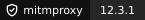
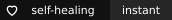

<div align="center">

<br><br>

  <br>
  <br>
   <br><br>

<a href="README.md">🇬🇧 English</a> · <a href="README.ru.md">🇷🇺 Русский</a> · <a href="README.zh.md">🇨🇳 中文</a>

<br><br>
<a href="https://github.com/nazavod777/agy-region-fixer/actions/workflows/cross-platform-test.yml"></a>

</div>

# 🌍 agy-region-fixer

> **Обход региональной блокировки Antigravity CLI** — один установщик, который работает на 🐧 Linux, 🍎 macOS и 🪟 Windows и переживает обновления CLI.

Google режет доступ по стране аккаунта. Локальный MITM-прокси вычищает `ineligibleTiers` из ответа `loadCodeAssist` — CLI видит только `allowedTiers` и пускает пользователя. Запросы к Google **не изменяются**, бинарь `agy` **не патчится**.

> [!WARNING]
> Обход регионального ограничения нарушает ToS Google. Используй на свой страх и риск, только со своим аккаунтом и подпиской.

## ✨ Возможности

| Возможность | Что это значит |
|---|---|
| 🧩 **Без патчинга** | `agy` остаётся нетронутым и лежит рядом как `agy.real` |
| ⚡ **Самовосстановление по событиям** | изменения файлов запускают восстановление; резервная проверка — каждые пять минут |
| 🛡️ **Защищённое восстановление** | на Linux снижает привилегии для целей в доступных пользователю каталогах; проверки готовности и блокировка снижают риск гонок |
| 🔒 **Только localhost** | прокси слушает `127.0.0.1`; чистятся только ответы `*.googleapis.com` |
| 🧪 **Межплатформенный CI** | проверки цикла Linux / macOS / Windows: установка → апдейт → heal → удаление |
| 🧹 **Чистое удаление** | `uninstall` возвращает бинарь на место и убирает всё остальное |

## 🎯 Что исправляет

Ровно **одну** вещь — региональное предупреждение, которое Antigravity CLI показывает сразу после запуска:

<div align="center">

<br><sub>Иллюстрация сообщения и результата, а не буквальный скриншот.</sub>
</div>

> `Eligibility check failed: Your current account is not eligible for Antigravity, because it is not currently available in your location.`

| ✅ Исправляет | ❌ Не исправляет |
|---|---|
| Региональную ошибку **Eligibility Check** выше | Авторизацию — рабочий `agy login` по-прежнему нужен |
| | Подписку, квоты и лимиты запросов |
| | Доступность моделей и любые серверные ограничения аккаунта |
| | Любую другую ошибку — если текст другой, утилита не поможет |

## 🚀 Установка

Сначала установи и залогинь Antigravity CLI (`agy login`), затем:

<table>
<tr><td>🐧 <b>Linux</b><br><sub>systemd: Ubuntu, Debian, Kali, Fedora, Arch, openSUSE</sub></td><td>

```bash
curl -fsSL https://raw.githubusercontent.com/nazavod777/agy-region-fixer/master/install.sh | sudo bash
```

</td></tr>
<tr><td>🍎 <b>macOS</b><br><sub>12+, Xcode Command Line Tools</sub></td><td>

```bash
curl -fsSL https://raw.githubusercontent.com/nazavod777/agy-region-fixer/master/install.sh | bash
```

</td></tr>
<tr><td>🪟 <b>Windows 10/11</b><br><sub>Python 3.12/3.13 с python.org, права администратора не нужны</sub></td><td>

```powershell
powershell -NoProfile -ExecutionPolicy Bypass -Command "iex (irm https://raw.githubusercontent.com/nazavod777/agy-region-fixer/master/install.ps1)"
```

</td></tr>
</table>

> [!NOTE]
> Однострочники `curl | bash` и `iex (irm …)` тянут `addon.py` с raw.githubusercontent.com. Хочешь сначала проверить код? Склонируй репозиторий и запусти `bash install.sh` / `install.ps1` из его каталога — `addon.py` подхватится рядом. Свой вариант аддона задаётся через `AGY_ADDON_URL=...`.

**Что делает установщик:** ставит mitmproxy в изолированный venv (системный Python не тронут) → поднимает автозапуск прокси (systemd / launchd / HKCU Run) → прячет настоящий бинарь в `agy.real` и ставит shim → включает самовосстановление → прогоняет smoke-тест `agy -p`.

### 📋 Требования

- 🐍 Python **3.12 или 3.13** (так требует mitmproxy 12.x), полная сборка с `ctypes`, `ssl` и `zlib`. Установщик проверяет все `python3.13`/`python3.12`/`python3` в `PATH` и пропускает неполные — например, Python, собранный из исходников без `libffi-dev`
- 🌐 `curl`, установленный и залогиненный Antigravity CLI
- 📦 **Любой способ установки `agy`** — установщик ищет его так же, как твоя оболочка (`sudo` прячет `~/.local/bin`, `/snap/bin`, nvm, bun, cargo…):
  - обычный бинарь, ссылка от npm/brew/cargo, `/usr/local/bin/agy` под root → бинарь переносится в `agy.real`, вместо него встаёт shim;
  - **snap, Nix** (лаунчер, который нельзя трогать) → лаунчер остаётся как есть, а обёртка ставится раньше него в твоём `PATH` (`~/.local/bin`). Для snap сертификат CA копируется в `~/snap/<имя>/common/agy-region-fixer`, где приложение под ограничениями может его прочитать.
- 🪟 **Один установщик Windows для всех поддерживаемых форматов:** `install.ps1` определяет обычный EXE, npm `.cmd`/`.ps1`, алиас WindowsApps или shim Scoop. Настоящая обёртка `agy.exe` собирается встроенным компилятором .NET Framework. Обычный бинарь сохраняется как `agy.real.exe`; управляемые лаунчеры сохраняют имена и файлы, а обёртка помещается в `%USERPROFILE%\.agy-region-fixer\bin`. Старые установки с `agy.cmd` мигрируют автоматически.
- 🐧 Linux: systemd и `runuser` или `setpriv` (оба из `util-linux`, есть везде)

## ⚙️ Как это работает


- `agy` → shim → если прокси жив, выставляет `SSL_CERT_FILE` (локальный CA) и `HTTPS_PROXY=127.0.0.1:PORT` → настоящий бинарь `agy.real`
- если прокси не запущен — shim просто зовёт `agy` без прокси: получишь прежнюю ошибку eligibility, но ничего не сломается
- по умолчанию в лог пишутся только факты чистки (`CLEANED …`)

## 🩹 Самовосстановление после апдейтов CLI

После обновления CLI восстановление shim запускается по событиям файловой системы. На всех платформах остаётся резервная проверка каждые пять минут; постоянного опроса файла CLI каждую секунду нет.

| ОС | Событийный триггер | Резервная проверка |
|---|---|---|
| 🐧 Linux | systemd path-юнит с `PathChanged` | таймер systemd |
| 🍎 macOS | launchd `WatchPaths` | отдельная задача с `StartInterval` |
| 🪟 Windows | .NET `FileSystemWatcher`, запускается при установке и входе пользователя | задача планировщика `agy-region-fixer-heal` |

Перед восстановлением серия событий объединяется. Восстановитель ждёт, пока файл перестанет меняться, и проверяет размер (≥ 10 МБ; на Windows ещё и сигнатуру `MZ`). Блокировка, подготовленная копия и проверки отката снижают риск гонок и помогают сохранить предыдущую рабочую копию. Это косвенные признаки готовности: стабильный файл не доказывает, что произвольный установщик закончил обновление.

Если установщик удалил заменяемый файл перед созданием нового, событийный запуск оставляет состояние `Pending`, чтобы не поставить shim в этот промежуток. Если файл так и не появился, ручной запуск или резервная проверка восстановят его из сохранённого бинаря. Управляемые лаунчеры остаются нетронутыми; восстанавливается только обёртка этой утилиты.

На Windows для переноса или переименования вышележащих каталогов, например профиля пользователя, может потребоваться сначала остановить наблюдатель. Резервная проверка каждые пять минут не освобождает открытые дескрипторы каталогов и не разблокирует такой перенос.

Запустить восстановление вручную:

- 🐧 `sudo agy-bypass-heal`
- 🍎 `bash ~/.agy-region-fixer/heal.sh`
- 🪟 `powershell %USERPROFILE%\.agy-region-fixer\heal.ps1`

## 🔐 Модель безопасности

На Linux heal запускается от root (systemd), а каталог с `agy` обычно принадлежит пользователю. Чтобы пользователь не мог превратить это в запись от root (подложенная ссылка, гонка по временному файлу), действует правило:

- 👤 если пользователь, записанный при установке, может писать в каталог цели, heal работает от его имени (`runuser`/`setpriv`); root может обрабатывать пути, если этому пользователю недоступна запись и в каталог исходного пути, и в каталог цели
- 🚫 если писать в каталог цели может только root, а путь `agy` лежит в каталоге пользователя (например, ссылка на системный файл) — heal **отказывается**, а не выполняет действие от root
- 🔑 подготовленная копия бинаря сохраняет исходных владельца, группу и обычные права доступа; при работе от root сначала применяется `fchown`, затем восстанавливаются права, а файлы с битами `setuid`/`setgid` отклоняются до копирования
- 🧱 `AGY_BYPASS_PREFIX` проверяется: абсолютный путь, не `/` и не `$HOME`, без символов `\ " ' % $`
- 🌐 прокси слушает только `127.0.0.1`, ключи и токены не покидают машину

## 🔧 Настройка

| Переменная | По умолчанию | Назначение | ОС |
|---|---|---|---|
| `AGY_BYPASS_PORT` | автоматически | порт прокси | 🐧 🍎 🪟 |
| `AGY_BYPASS_PREFIX` | `/opt/agy-region-fixer` · `~/.agy-region-fixer` | каталог установки | 🐧 🍎 |
| `AGY_BYPASS_BIN` | поиск `agy` в `PATH` | путь к бинарю CLI | 🐧 🍎 |
| `AGY_ADDON_URL` | raw.githubusercontent.com | откуда брать `addon.py` при pipe-установке | 🐧 🍎 🪟 |

По умолчанию выбирается случайный свободный порт localhost в диапазоне `49152–65535` и сохраняется в `<каталог установки>/port`. Повторная установка использует этот высокий порт, если он доступен; иначе выбирает другой. `AGY_BYPASS_PORT` явно задаёт порт: если он занят, установка остановится с ошибкой. Фактический адрес выводится на экран и согласованно записывается в настройки прокси и всех обёрток. Ctrl+C прерывает установщик и его временные команды; уже запущенный фоновый прокси работает до запуска uninstall.

```bash
AGY_BYPASS_PORT=8081 bash install.sh          # Linux — с sudo
```
```powershell
$env:AGY_BYPASS_PORT="8081"; powershell -ExecutionPolicy Bypass -File install.ps1
```

## 🧹 Удаление

- 🐧 `sudo /opt/agy-region-fixer/uninstall.sh`
- 🍎 `bash ~/.agy-region-fixer/uninstall.sh`
- 🪟 `powershell -ExecutionPolicy Bypass -File %USERPROFILE%\.agy-region-fixer\uninstall.ps1`

Убирает прокси, задачи и shim; бинарь `agy` возвращается на место — даже если после прерванного апдейта он остался только как `agy.real`.

## 🩺 Диагностика

| ОС | Лог прокси | Журнал сервиса |
|---|---|---|
| 🐧 Linux | `/opt/agy-region-fixer/mitm.log` | `journalctl -u agy-region-fixer -e` |
| 🍎 macOS | `~/.agy-region-fixer/mitm.log` | `~/.agy-region-fixer/launchd.err` |
| 🪟 Windows | `%USERPROFILE%\.agy-region-fixer\mitm.log` | `…\mitm-stdout.log` |

🔎 **Подробный режим:** полный лог всех URL включается файлом `verbose.flag` в каталоге установки (`touch /opt/agy-region-fixer/verbose.flag`; на Windows — создай файл в `%USERPROFILE%\.agy-region-fixer`). Перезапускать прокси не нужно — флаг проверяется на каждый запрос; удалишь файл — режим выключится.

🔬 В подробном режиме аддон пишет ещё и **форму** каждого JSON-ответа Google (`SHAPE <метод> <url> <статус> -> {поле: тип}`): только имена и типы полей, значений нет (кроме перечислений вроде `reasonCode` и `tierId`). Если после установки предупреждение осталось, по этим строкам видно, изменилось ли API — приложи `SHAPE` к issue.

Прокси запускает `addon.py` напрямую через Python из venv (`python -I addon.py --port PORT --confdir CA_DIR`) и однократно регистрирует обработчики фильтрации. Автоматическая перезагрузка скриптов mitmdump и ежесекундная проверка файла аддона не используются. Изменения `addon.py` вступают в силу после перезапуска прокси; повторный запуск установщика восстановит файлы и перезапустит его. Свой файл из `AGY_ADDON_URL` по-прежнему может содержать только обработчики mitmproxy: он сохраняется как `custom-addon.py`, а стандартный код запуска однократно загружает его через `--addon`. Изменения этого файла тоже требуют перезапуска прокси. Для удаления используй скрипт uninstall.

## ⚠️ Ограничения

- 🪟 Если Windows-версия CLI использует лаунчер, после установки открой новый терминал, чтобы обновился пользовательский `PATH`. Программы должны находить установленную обёртку `agy.exe` или запускать её по полному пути; абсолютный запуск исходного управляемого лаунчера обходит её. Системная запись `PATH` может иметь приоритет над пользовательской — проверь, какой `agy` находит приложение.
- 🧬 Если Google сменит формат ответа (переименует поле или уйдёт в бинарный proto) — аддон перестанет чистить; чинится одной строкой в `addon.py`.
- 📌 Если `agy` начнёт certificate pinning (Go-клиенты почти никогда) — способ потребует переработки.

## ✅ Статус тестирования

Задания GitHub Actions на соответствующих ОС по ссылкам ниже прошли успешно. Linux и macOS проверены на `bc1495b`; Windows — на `2cda8ef`, после изменений только в установщике Windows, тестах наблюдателя и шаге CI для Windows.

| 🐧 ubuntu-latest | 🍎 macos-latest | 🪟 windows-latest |
|:---:|:---:|:---:|
| [✅ systemd](https://github.com/nazavod777/agy-region-fixer/actions/runs/43772344364/job/132990856460) | [✅ launchd](https://github.com/nazavod777/agy-region-fixer/actions/runs/43772344364/job/132990856534) | [✅ HKCU Run + schtasks](https://github.com/nazavod777/agy-region-fixer/actions/runs/43773308497/job/132993835041) |

Проверки используют тестовую имитацию CLI и охватывают прокси и CA, автоматическое восстановление по событиям, сценарии наблюдателя и удаление. Задание Windows также подтвердило HTTPS через прокси и отклонение неверного CA. Настоящий `agy login` и реальные запросы CLI к API Google в CI не проверяются. Windows работает с правами администратора и отключённым контролем учётных записей (UAC), поэтому планировщик задач под обычной учётной записью и настоящий AppExecAlias остаются непроверенными.

Прежняя живая проверка Linux с настоящим CLI и моделью дала `BYPASS_OK`; это исторический результат, а не новая проверка этой версии.

## 🗂️ Структура

```
agy-region-fixer/
├── install.sh      # 🐧🍎 установщик Linux / macOS (+ генерирует heal.sh, uninstall.sh)
├── install.ps1     # 🪟 установщик Windows
├── addon.py        # 🧩 аддон mitmproxy — единственный источник логики чистки
├── assets/         # 🎨 SVG для README
└── .github/workflows/cross-platform-test.yml
```

## 🤝 Авторство

| Роль | Кто |
|---|---|
| 👤 **Автор и мейнтейнер** | [**nazavod777**](https://github.com/nazavod777) |
| 🤖 **Инструменты разработки (ИИ)** | **Claude** и **Claude Code** (Anthropic) · **Hermes** (агентный харнесс) · модели **GLM** (Z.ai) · **T3 Code** (терминал) |

ИИ-инструменты использовались как помощники в разработке — спасибо их командам. Решения, ревью и ответственность за код — на авторе.

## 📄 Лицензия

[MIT](LICENSE)

---

<div align="center"><sub>Нравится проект? Поддержи автора ☕</sub></div>

<div align="center">

<a href="https://nazavod.dev"></a> <a href="https://t.me/bio_nazavod"></a> <a href="https://github.com/nazavod777"></a> <a href="https://x.com/nazavod777"></a> <a href="https://antidrain.me"></a>

<br><br>
<a href="https://nazavod.dev/coffee/"></a>

</div>
