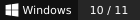
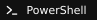
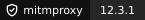
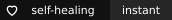
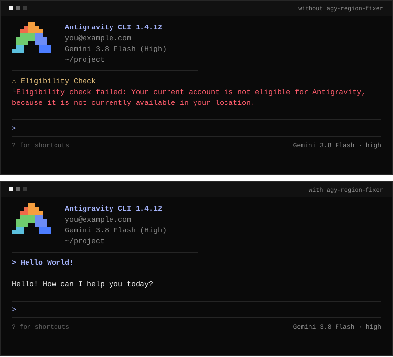
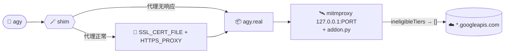

<div align="center">

<br><br>

  <br>
  <br>
   <br><br>

<a href="README.md">🇬🇧 English</a> · <a href="README.ru.md">🇷🇺 Русский</a> · <a href="README.zh.md">🇨🇳 中文</a>

<br><br>
<a href="https://github.com/nazavod777/agy-region-fixer/actions/workflows/cross-platform-test.yml"></a>

</div>

# 🌍 agy-region-fixer

> **Antigravity CLI 地区限制绕过工具** —— 一个安装脚本，支持 🐧 Linux、🍎 macOS 和 🪟 Windows，CLI 更新后依然有效。

Google 会根据账号所在国家限制访问。本地 MITM 代理会从 `loadCodeAssist` 响应中清除 `ineligibleTiers` 字段，CLI 只会看到 `allowedTiers` 并放行。发往 Google 的请求**不会被修改**，`agy` 二进制文件**不会被打补丁**。

> [!WARNING]
> 绕过地区限制违反 Google 服务条款。风险自负，请仅用于你自己的账号和订阅。

## ✨ 特性

| 特性 | 说明 |
|---|---|
| 🧩 **无需打补丁** | `agy` 保持原样，以 `agy.real` 的名字放在 shim 旁边 |
| ⚡ **事件触发自愈** | 文件系统事件触发修复，并保留五分钟备用检查 |
| 🛡️ **修复保护** | Linux 上对用户可写目录中的目标降低运行权限；就绪检查和锁降低更新竞争风险 |
| 🔒 **仅限本机** | 代理只监听 `127.0.0.1`；只清理 `*.googleapis.com` 的响应 |
| 🧪 **跨平台 CI** | Linux / macOS / Windows 生命周期工作流：安装 → 更新 → 自愈 → 卸载 |
| 🧹 **干净卸载** | `uninstall` 会还原二进制文件并删除其余所有内容 |

## 🎯 修复什么

只修复**一件事** —— Antigravity CLI 启动后立即显示的地区警告：

<div align="center">

<br><sub>消息与效果的示意图，并非真实截图。</sub>
</div>

> `Eligibility check failed: Your current account is not eligible for Antigravity, because it is not currently available in your location.`

| ✅ 能修复 | ❌ 不能修复 |
|---|---|
| 上面的地区 **Eligibility Check** 错误 | 登录 —— 仍然需要可用的 `agy login` |
| | 订阅、配额或速率限制 |
| | 模型可用性或任何账号的服务端限制 |
| | 其他任何错误 —— 如果提示不同，本工具无法解决 |

## 🚀 安装

请先安装并登录 Antigravity CLI（`agy login`），然后：

<table>
<tr><td>🐧 <b>Linux</b><br><sub>systemd：Ubuntu、Debian、Kali、Fedora、Arch、openSUSE</sub></td><td>

```bash
curl -fsSL https://raw.githubusercontent.com/nazavod777/agy-region-fixer/master/install.sh | sudo bash
```

</td></tr>
<tr><td>🍎 <b>macOS</b><br><sub>12+，需要 Xcode Command Line Tools</sub></td><td>

```bash
curl -fsSL https://raw.githubusercontent.com/nazavod777/agy-region-fixer/master/install.sh | bash
```

</td></tr>
<tr><td>🪟 <b>Windows 10/11</b><br><sub>python.org 的 Python 3.12/3.13，无需管理员权限</sub></td><td>

```powershell
powershell -NoProfile -ExecutionPolicy Bypass -Command "iex (irm https://raw.githubusercontent.com/nazavod777/agy-region-fixer/master/install.ps1)"
```

</td></tr>
</table>

> [!NOTE]
> `curl | bash` 和 `iex (irm …)` 一行命令会从 raw.githubusercontent.com 下载 `addon.py`。想先审查代码？克隆仓库后在其目录下运行 `bash install.sh` / `install.ps1`，会自动使用旁边的 `addon.py`。要使用自己的版本，请设置 `AGY_ADDON_URL=...`。

**安装脚本会做什么：** 把 mitmproxy 装进独立 venv（不动系统 Python）→ 配置代理开机自启（systemd / launchd / HKCU Run）→ 把真正的二进制文件移到 `agy.real` 并放置 shim → 启用自愈 → 运行 `agy -p` 冒烟测试。

### 📋 环境要求

- 🐍 Python **3.12 或 3.13**（mitmproxy 12.x 的要求），且须为包含 `ctypes`、`ssl`、`zlib` 的完整构建。安装脚本会检查 `PATH` 中所有 `python3.13`/`python3.12`/`python3`，并跳过不完整的版本（例如未安装 `libffi-dev` 就从源码编译的 Python）
- 🌐 `curl`，以及已安装并登录的 Antigravity CLI
- 📦 **任何方式安装的 `agy`** —— 安装脚本像你自己的 shell 一样查找它（`sudo` 会隐藏 `~/.local/bin`、`/snap/bin`、nvm、bun、cargo 等）：
  - 普通二进制文件、npm/brew/cargo 的链接、root 所有的 `/usr/local/bin/agy` → 二进制文件被移到 `agy.real`，由 shim 取代；
  - **snap、Nix**（不能改动的启动器）→ 启动器保持原样，在你的 `PATH` 中更靠前的位置（`~/.local/bin`）放置一个包装脚本。对于 snap，CA 证书会复制到 `~/snap/<名称>/common/agy-region-fixer`，受限应用可以读取该目录。
- 🪟 **所有支持格式共用一个 Windows 安装脚本：** `install.ps1` 自动识别普通 EXE、npm `.cmd`/`.ps1`、WindowsApps 别名和 Scoop shim，使用 Windows 自带的 .NET Framework 编译器生成真正的 `agy.exe` 包装器。普通二进制保存为 `agy.real.exe`；受管理的启动器保留原名和文件，包装器放在 `%USERPROFILE%\.agy-region-fixer\bin`。旧的 `agy.cmd` 安装会自动迁移。
- 🐧 Linux：systemd，以及 `runuser` 或 `setpriv`（都包含在 `util-linux` 中）

## ⚙️ 工作原理



- `agy` → shim → 若代理正常，则设置 `SSL_CERT_FILE`（本地 CA）和 `HTTPS_PROXY=127.0.0.1:PORT` → 真正的二进制 `agy.real`
- 若代理未运行，shim 会直接调用 `agy`：你会看到原来的资格错误，但不会损坏任何东西
- 默认日志只记录清理事件（`CLEANED …`）

## 🩹 CLI 更新后的自愈

CLI 更新后，文件系统事件会触发 shim 修复。所有平台都保留每五分钟一次的备用检查；不会常驻循环每秒轮询 CLI 文件。

| 系统 | 事件触发方式 | 备用检查 |
|---|---|---|
| 🐧 Linux | 使用 `PathChanged` 的 systemd path 单元 | systemd 定时器 |
| 🍎 macOS | launchd `WatchPaths` | 独立的 `StartInterval` 任务 |
| 🪟 Windows | .NET `FileSystemWatcher`，安装时及用户登录时启动 | 计划任务 `agy-region-fixer-heal` |

连续事件会先合并，再执行修复。恢复程序等待文件停止变化，并检查大小（≥ 10 MB；Windows 上还检查 `MZ` 签名）。锁、暂存副本和回滚检查用于降低竞争风险并保留先前可用的副本。这些只是就绪状态的间接判断：文件暂时稳定，并不能证明任意更新程序已完成更新。

如果更新程序先删除原位目标，再创建替代文件，事件触发的修复会保留 `Pending` 状态，避免在这个间隙放回 shim。如果文件一直没有出现，手动运行或五分钟备用检查会使用保存的二进制文件修复。受管理的启动器保持不变；只修复本工具自己的包装器。

在 Windows 上，移动或重命名更高层目录（例如用户配置文件目录）前，可能需要先停止监视程序。五分钟备用检查不会释放目录句柄，也不能解除对此类移动操作的阻止。

手动运行修复：

- 🐧 `sudo agy-bypass-heal`
- 🍎 `bash ~/.agy-region-fixer/heal.sh`
- 🪟 `powershell %USERPROFILE%\.agy-region-fixer\heal.ps1`

## 🔐 安全模型

在 Linux 上 heal 由 root（systemd）启动，而存放 `agy` 的目录通常属于普通用户。为了防止用户借此以 root 身份写文件（被替换的符号链接、临时文件竞争），规则如下：

- 👤 如果安装时记录的用户可写入目标目录，heal 会通过 `runuser`/`setpriv` 以该用户身份运行；只有原始路径和目标路径的目录都不允许该用户写入时，才可能由 root 处理
- 🚫 如果只有 root 能写入目标目录，而 `agy` 的路径位于用户可控的目录中（例如指向系统文件的链接），heal 会**拒绝**执行，而不是以 root 身份操作
- 🔑 暂存的二进制副本保留原始所有者、所属组和普通权限位；以 root 运行时先执行 `fchown` 再恢复权限，带有 `setuid`/`setgid` 位的候选文件会在复制前被拒绝
- 🧱 会校验 `AGY_BYPASS_PREFIX`：必须是绝对路径，不能是 `/` 或 `$HOME`，且不含 `\ " ' % $`
- 🌐 代理只监听 `127.0.0.1`，密钥和令牌不会离开本机

## 🔧 配置

| 变量 | 默认值 | 用途 | 系统 |
|---|---|---|---|
| `AGY_BYPASS_PORT` | 自动选择 | 代理端口 | 🐧 🍎 🪟 |
| `AGY_BYPASS_PREFIX` | `/opt/agy-region-fixer` · `~/.agy-region-fixer` | 安装目录 | 🐧 🍎 |
| `AGY_BYPASS_BIN` | 在 `PATH` 中查找 `agy` | CLI 二进制路径 | 🐧 🍎 |
| `AGY_ADDON_URL` | raw.githubusercontent.com | 管道安装时下载 `addon.py` 的地址 | 🐧 🍎 🪟 |

默认从 `49152–65535` 中随机选择空闲的 localhost 端口，并保存到 `<安装目录>/port`。重新安装会尽量复用该高位端口；若不可用则重新选择。`AGY_BYPASS_PORT` 显式指定端口，占用时安装会报错。安装脚本会显示实际地址，并同步更新代理和所有包装脚本。Ctrl+C 会中断安装脚本及其临时命令；已启动的后台代理会持续运行，直到执行卸载脚本。

```bash
AGY_BYPASS_PORT=8081 bash install.sh          # Linux 需要 sudo
```
```powershell
$env:AGY_BYPASS_PORT="8081"; powershell -ExecutionPolicy Bypass -File install.ps1
```

## 🧹 卸载

- 🐧 `sudo /opt/agy-region-fixer/uninstall.sh`
- 🍎 `bash ~/.agy-region-fixer/uninstall.sh`
- 🪟 `powershell -ExecutionPolicy Bypass -File %USERPROFILE%\.agy-region-fixer\uninstall.ps1`

会移除代理、任务和 shim；`agy` 二进制文件会回到原位 —— 即使更新中断后它只剩下 `agy.real`。

## 🩺 诊断

| 系统 | 代理日志 | 服务日志 |
|---|---|---|
| 🐧 Linux | `/opt/agy-region-fixer/mitm.log` | `journalctl -u agy-region-fixer -e` |
| 🍎 macOS | `~/.agy-region-fixer/mitm.log` | `~/.agy-region-fixer/launchd.err` |
| 🪟 Windows | `%USERPROFILE%\.agy-region-fixer\mitm.log` | `…\mitm-stdout.log` |

🔎 **详细模式：** 在安装目录中创建 `verbose.flag` 文件即可记录所有 URL（`touch /opt/agy-region-fixer/verbose.flag`；Windows 上在 `%USERPROFILE%\.agy-region-fixer` 中创建该文件）。无需重启代理 —— 每个请求都会检查该文件；删除文件即可关闭。

🔬 详细模式下，插件还会记录 Google 每个 JSON 响应的**结构**（`SHAPE <方法> <url> <状态> -> {字段: 类型}`）：只记录字段名和类型，不记录值（`reasonCode`、`tierId` 等枚举除外）。如果安装后警告仍在，这些行可以显示 API 是否变化 —— 请把 `SHAPE` 行附在 issue 中。

代理通过 venv 中的 Python 直接运行 `addon.py`（`python -I addon.py --port PORT --confdir CA_DIR`），并只注册一次过滤钩子。它不使用 mitmdump 的脚本自动重载器，也不会每秒检查插件文件。修改 `addon.py` 后需要重启代理才会生效；重新运行安装脚本可恢复文件并重启代理。自定义 `AGY_ADDON_URL` 仍可提供仅包含 mitmproxy 钩子的插件：文件保存为 `custom-addon.py`，由标准启动程序通过 `--addon` 加载一次。修改该文件后也需要重启代理。需要移除安装时，请使用卸载脚本。

## ⚠️ 限制

- 🪟 Windows 启动器模式安装后，请打开新终端以使用更新后的用户 `PATH`。程序需要解析到已安装的 `agy.exe` 包装器，或通过其完整路径启动；直接调用原始启动器的绝对路径会绕过包装器。系统 `PATH` 可能优先于用户 `PATH`，请检查应用实际找到的 `agy`。
- 🧬 如果 Google 更改响应格式（字段改名或改用二进制 proto），插件将停止清理；在 `addon.py` 中改一行即可修复。
- 📌 如果 `agy` 启用证书固定（Go 客户端几乎从不这样做），此方案需要重做。

## ✅ 测试状态

GitHub Actions 工作流在各系统的原生运行器上检查生命周期：安装 → 代理 + CA + MITM 检查 → shim → 模拟 CLI 更新 → 自愈 → 竞争、被替换链接和符号链接攻击检查 → 还原二进制文件的干净卸载。

| 🐧 ubuntu-latest | 🍎 macos-latest | 🪟 windows-latest |
|:---:|:---:|:---:|
| systemd | launchd | HKCU Run + schtasks |

事件触发修复和插件直接启动仍需在各系统上重新运行工作流；上表说明检查范围，不代表此版本已通过。

CI 不测试真实的 `agy login` 和 Google 流量（使用假的 `agy`）；Linux 路径另外用真实 CLI 和模型做过实机验证（`BYPASS_OK`）。

## 🗂️ 目录结构

```
agy-region-fixer/
├── install.sh      # 🐧🍎 Linux / macOS 安装脚本（生成 heal.sh、uninstall.sh）
├── install.ps1     # 🪟 Windows 安装脚本
├── addon.py        # 🧩 mitmproxy 插件 —— 清理逻辑的唯一来源
├── assets/         # 🎨 README 用的 SVG
└── .github/workflows/cross-platform-test.yml
```

## 🤝 致谢

| 角色 | 成员 |
|---|---|
| 👤 **作者与维护者** | [**nazavod777**](https://github.com/nazavod777) |
| 🤖 **开发所用 AI 工具** | **Claude** 与 **Claude Code**（Anthropic）· **Hermes**（智能体 harness）· **GLM** 模型（Z.ai）· **T3 Code**（终端） |

以上 AI 工具仅作为开发助手使用，感谢各团队。设计决策、审查和代码责任均由作者承担。

## 📄 许可证

[MIT](LICENSE)

---

<div align="center"><sub>喜欢这个项目？请作者喝杯咖啡 ☕</sub></div>

<div align="center">

<a href="https://nazavod.dev"></a> <a href="https://t.me/bio_nazavod"></a> <a href="https://github.com/nazavod777"></a> <a href="https://x.com/nazavod777"></a> <a href="https://antidrain.me"></a>

<br><br>
<a href="https://nazavod.dev/coffee/"></a>

</div>
